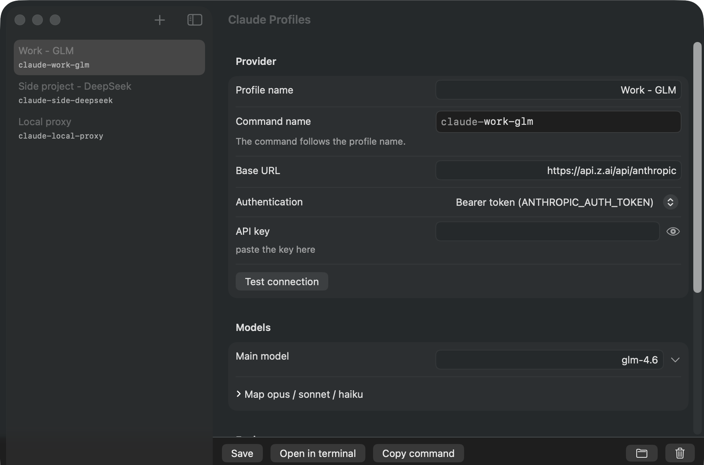
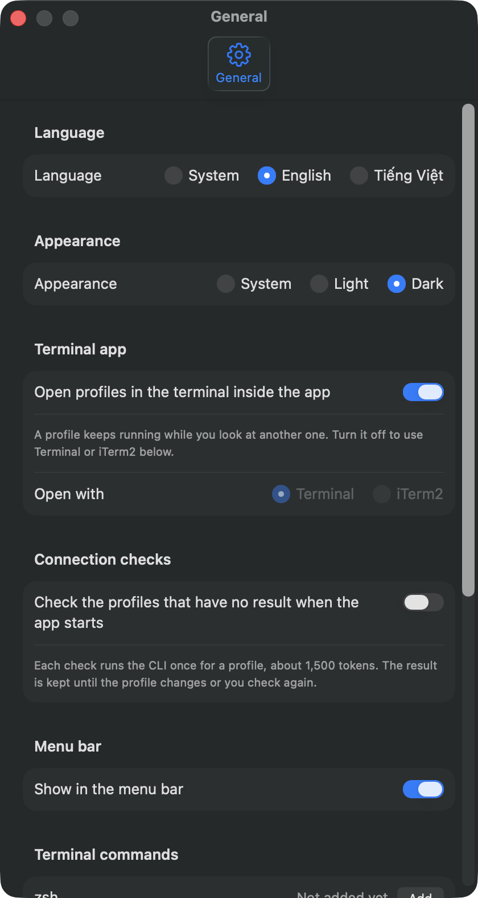

# Agent Profiles

**Run Claude Code with any AI provider, each one in its own profile.**

English · [Tiếng Việt](README.vi.md)

  

Claude Code can work with many AI providers, not only one. The catch is that every
provider needs its own address, its own key and its own model names, and switching between
them usually means editing settings by hand or keeping a pile of scripts.

Agent Profiles turns each provider into a **profile** you can create in a minute. Every
profile gets its own command. Type `claude-work-glm` in any terminal and you are working
with that provider. Type `claude-side-deepseek` and you are working with another one. Your
keys stay safe, and your normal Claude Code setup is never touched.

## What you get

- **One profile per provider.** Give it a name, an address, a key and a model. Done.
- **One command per profile.** The command is named after the profile (you can rename it)
  and works from any terminal, in any folder.
- **Ready-made templates** for OpenRouter, DeepSeek, Kimi, GLM, MiniMax and a local proxy.
  Pick one and the address fills itself in.
- **Keys kept in the macOS Keychain.** Your keys are never saved in a plain file.
- **Your own Claude Code stays as it is.** Each profile keeps its own settings and history,
  so nothing leaks from one to another. If you like, you can share your instructions, skills
  and agents across all of them.
- **A dot that tells you if it works.** *Test connection* asks the CLI for one short answer, the way your
  own command does, and tells you what is wrong: the key, the address, the model name, the sign-in or the
  network. The result is kept between runs, so you see the state of every profile as soon as you open the app.
- **Pick the model from a list.** Type any model name, or choose from the ones your provider
  offers.
- **Opens right where you work.** Start a profile in Terminal or iTerm2, straight in your
  project folder.
- **Clean removal.** Delete a profile and everything that belongs to it goes with it.
- **English and Vietnamese**, with a light or dark look that follows your Mac.
- **Updates itself.** The app tells you when a new version is out and installs it with one
  click, after checking that it really comes from us.

  
  &nbsp;
  

## Install

You need a Mac with **Apple Silicon** running **macOS 14 or later**.

1. Download the latest `Agent-Profiles-<version>.dmg` from the
   [Releases page](https://github.com/tamnt1707/agent-profiles/releases/latest).
2. Open it and drag **Agent Profiles** into **Applications**.
3. The first time, right-click the app and choose **Open**. macOS asks once because the app is
   not notarized by Apple yet.

## Get started in three steps

1. Click **+**, pick a provider template (or start from scratch) and type a name.
2. Paste your key and click **Test connection**. Then **Save**.
3. Click **Open in terminal**, or type the profile's command in any terminal.

When you save your first profile, the app offers to make the commands work in every terminal.
It asks first, and you can undo it at any time from the settings.

## Questions

**Is my key safe?**
Your key is stored in the macOS Keychain, the same place your Mac keeps passwords. It is never
written to a file, and it is sent only to the address you typed for that profile.

**Will it change how my normal Claude Code works?**
No. Your own Claude Code settings are left alone. Each profile has a separate space of its own.

**Which providers can I use?**
Any provider that offers a Claude-compatible address. The templates cover the popular ones, and
you can type any other address by hand.

**What does *Test connection* cost?**
One short request through the CLI: about 1,500 tokens in and a few out. The app also does it once for a profile
that has no result yet when it starts; the result is kept until the profile changes or you check again. You can
turn the check at start off in Settings.

**What happens when I delete a profile?**
Its key, its command and its saved history are all removed. If it was your last profile, the app
also offers to remove the terminal setup it added.

**Does it work on an Intel Mac?**
Not yet. Version 0.1 runs on Apple Silicon only.

## More

- [What is new in each version](CHANGELOG.md)
- [Building the app yourself](docs/BUILDING.md)

Agent Profiles is an independent project. It is not made by, or affiliated with, Anthropic or
any of the providers it can connect to. All product names belong to their owners.
