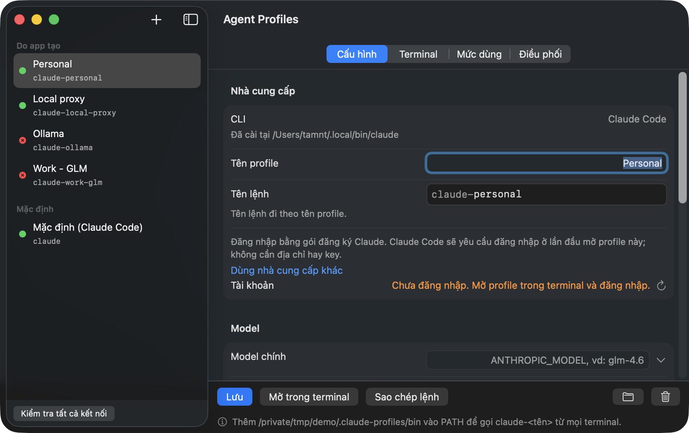
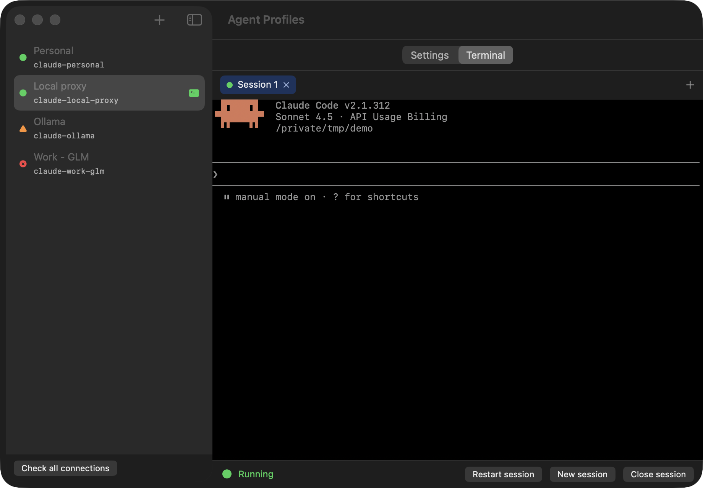
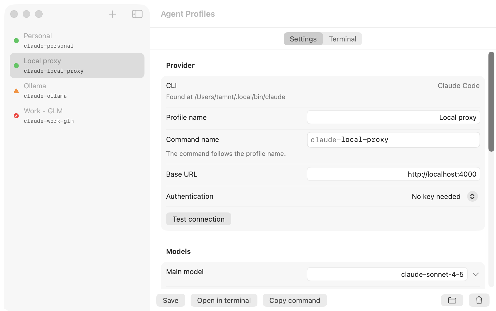
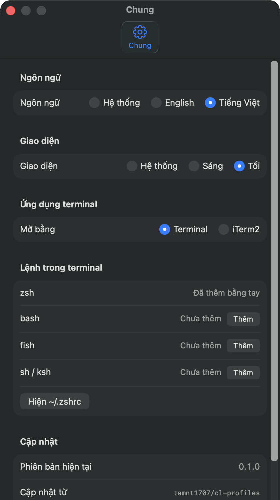

# Agent Profiles

**Chạy Claude Code với bất kỳ nhà cung cấp AI nào, mỗi nhà một profile riêng.**

[English](README.md) · Tiếng Việt

<p align="center">
  
</p>

Claude Code dùng được với nhiều nhà cung cấp AI chứ không chỉ một. Vướng ở chỗ mỗi nhà cung cấp
cần địa chỉ, key và tên model riêng, nên việc chuyển qua lại thường phải sửa cài đặt bằng tay
hoặc giữ một đống script.

Agent Profiles biến mỗi nhà cung cấp thành một **profile** bạn tạo được trong một phút. Mỗi
profile có một lệnh riêng. Gõ `claude-work-glm` ở terminal nào cũng là bạn đang làm việc với
nhà cung cấp đó. Gõ `claude-side-deepseek` là bạn làm việc với nhà khác. Key của bạn được giữ an
toàn, và Claude Code thông thường của bạn không bị đụng tới.

Hiện nay CLI mà app chạy là Claude Code. Các agent khác có thể được thêm sau, vì vậy app có tên
Agent Profiles.

## Bạn nhận được gì

- **Một profile cho mỗi nhà cung cấp.** Đặt tên, nhập địa chỉ, key và model. Xong.
- **Terminal ngay trong ứng dụng.** Mở một profile là terminal của nó nằm ngay trong cửa sổ, có tab
  (*Phiên mới*, *Khởi động lại phiên*, *Đóng phiên*). Profile vẫn chạy khi bạn xem profile khác, và cột bên
  đánh dấu những profile đang chạy. Mỗi tab mới hỏi cách mở: *Bình thường* hoặc điều phối (xem bên dưới). Thích
  Terminal hoặc iTerm2 hơn? Đổi trong cài đặt.
- **Một lệnh cho mỗi profile.** Lệnh đặt theo tên profile (bạn đổi tên được) và chạy được ở
  terminal nào, thư mục nào.
- **Mẫu có sẵn** cho gói đăng ký Claude của bạn (không cần địa chỉ và key, chỉ cần đăng nhập), OpenRouter,
  DeepSeek, Kimi, GLM, MiniMax, Xiaomi MiMo và proxy nội bộ. Chọn một mẫu là địa chỉ tự điền.
- **Có chấm cho biết kết nối có chạy không.** App nhờ CLI trả lời một câu ngắn, giống cách lệnh của bạn làm, và
  nói chỗ nào sai: key, địa chỉ, tên model, đăng nhập hay mạng. Kết quả được giữ giữa các lần mở, nên bạn thấy ngay
  trạng thái của mọi profile khi mở ứng dụng, và *Kiểm tra kết nối* chỉ làm mới kết quả đó.
- **Key nằm trong Keychain của macOS.** Key không bao giờ được lưu trong file thường.
- **Claude Code của bạn vẫn như cũ.** Mỗi profile có cài đặt và lịch sử riêng, nên không có gì
  lẫn từ profile này sang profile khác. Nếu muốn, bạn có thể dùng chung hướng dẫn, kỹ năng và
  agent cho tất cả.
- **Bộ Orchestration.** Một nút thêm một bộ subagent (scout, researcher, builder, tester, reviewer, committer) và
  hướng dẫn cho phiên chính vào một profile, để model mạnh lo lập kế hoạch còn các model rẻ hơn lo đọc và gõ. Không có
  gì ngoài profile đó bị đụng tới. Có hai quy trình, mỗi quy trình được vẽ thành sơ đồ trong app: *Tuần tự* (agent điều
  phối giao từng bước) và *Hàng đợi* (coder merge vào nhánh task khi qua lint và format, thư ký ghi hàng đợi, tester
  làm theo đúng thứ tự, và chưa gì được merge lên nhánh cao hơn cho đến khi mọi thứ xanh). Quy trình hàng đợi thêm
  `frontend-2d`, `frontend-3d`, `backend` và `secretary`. Cài lại sẽ cập nhật agent tại chỗ (có bản `.bak`) và gỡ những
  agent kit đã bỏ.
- **Mở với vai trò điều phối.** Ở tab Terminal, chọn *Điều phối* khi mở tab: Claude chạy với Opus effort medium và
  hướng dẫn của quy trình, chỉ cho phiên đó. Agent còn thiếu được cài trước, và `CLAUDE.md` không bị sửa.
- **Heartbeat cho cửa sổ 5 giờ.** Chọn giờ (và ngày) để app gửi một `ping` rất nhỏ qua CLI của profile, để cửa sổ
  dùng của gói subscription bắt đầu đúng lúc bạn muốn. Chạy cả khi app đã đóng, và cho bạn thấy ping gần nhất đã đi
  lúc nào và kết thúc ra sao.
- **Claude Code của chính bạn cũng nằm trong danh sách.** *Mặc định* (`~/.claude`) nằm dưới các profile do app tạo,
  có terminal, mức dùng và cùng chấm trạng thái. Không bao giờ xóa được từ app.
- **Trình khởi chạy trên thanh menu.** Mở bất kỳ profile nào chỉ bằng một cú nhấp, trong thư mục riêng của nó hoặc
  một trong năm thư mục bạn dùng gần nhất.
- **Thống kê token theo profile.** Xem hôm nay, 7 ngày gần nhất và tất cả, đếm ngay trên máy bạn từ lịch sử riêng của
  profile, kèm đơn giá mỗi triệu token (tùy chọn) để ước tính chi phí.
- **Chọn model từ danh sách.** Gõ tên model nào cũng được, hoặc chọn từ những model nhà cung cấp
  đưa ra.
- **Xóa sạch.** Xóa một profile (kể cả từ chính dòng của nó) là mọi thứ thuộc về nó đi theo.
- **Tiếng Anh và tiếng Việt**, giao diện sáng hoặc tối theo máy của bạn.
- **Tự cập nhật.** App báo khi có bản mới và cài bằng một cú bấm, sau khi kiểm tra bản đó thật sự
  đến từ chúng tôi.

<p align="center">
  
</p>

<p align="center">
  
  &nbsp;
  
</p>

## Cài đặt

Bạn cần một máy Mac **Apple Silicon** chạy **macOS 14 trở lên**.

1. Tải file `Agent-Profiles-<phiên bản>.dmg` mới nhất ở
   [trang Releases](https://github.com/tamnt1707/agent-profiles/releases/latest).
2. Mở file và kéo **Agent Profiles** vào **Applications**.
3. Lần đầu, bấm chuột phải vào app rồi chọn **Mở**. macOS chỉ hỏi một lần, vì app chưa được Apple
   notarize.

Thích dùng lệnh hơn? Một trong hai cách dưới đây cài app và không cần bấm chuột phải:

```sh
# script của repo này: bản mới nhất vào /Applications
curl -fsSL https://raw.githubusercontent.com/tamnt1707/agent-profiles/main/scripts/install.sh | bash

# hoặc Homebrew
brew tap tamnt1707/agent-profiles https://github.com/tamnt1707/agent-profiles
brew install --cask agent-profiles
```

Script nhận `--version 0.6.0` để cài đúng một phiên bản và `--uninstall` để gỡ app (profile và key được giữ).
App tự cập nhật sau đó, nên không cần `brew upgrade`.

Đang dùng **Claude Profiles 0.2.0**? Hãy tải bản này bằng tay một lần, vì app cũ không tự cập nhật lên một app đổi
tên được, rồi xóa `Claude Profiles.app` cũ. Profile, key và lệnh của bạn được giữ nguyên.

## Bắt đầu trong ba bước

1. Bấm **+**, chọn CLI và một mẫu nhà cung cấp (hoặc bắt đầu từ trống) và gõ tên.
2. Dán key và bấm **Kiểm tra kết nối**. Rồi **Lưu**.
3. Mở tab **Terminal**, hoặc bấm **Mở trong terminal**, hoặc gõ lệnh của profile ở terminal bất kỳ.

Khi bạn lưu profile đầu tiên, app hỏi có làm cho các lệnh chạy được ở mọi terminal không. App
luôn hỏi trước, và bạn hoàn tác được bất cứ lúc nào trong phần cài đặt.

## Câu hỏi thường gặp

**Key của tôi có an toàn không?**
Key được lưu trong Keychain của macOS, cùng chỗ máy Mac giữ mật khẩu. Key không bao giờ được ghi ra
file, và chỉ được gửi đến địa chỉ bạn đã nhập cho profile đó.

**Có làm thay đổi cách Claude Code thông thường của tôi không?**
Không. Cài đặt Claude Code của bạn được để yên. Mỗi profile có một không gian riêng.

**Dùng được với nhà cung cấp nào?**
Bất kỳ nhà cung cấp nào có địa chỉ tương thích Claude. Các mẫu có sẵn phủ những nhà phổ biến, còn
địa chỉ khác bạn gõ tay. Hoặc dùng gói đăng ký Claude của bạn: chọn mẫu đó và đăng nhập ở lần đầu mở profile.

**Hỗ trợ những CLI nào?**
Hiện là Claude Code. Khi tạo profile, app tìm các CLI đã cài trên máy bạn. Các CLI khác đang được lên kế hoạch.

**Dữ liệu của tôi nằm ở đâu?**
Trong `~/.claude-profiles` (profile, launcher, một thư mục cấu hình cho mỗi profile) và Keychain của macOS (key). Thư
mục giữ tên ban đầu của app, nên không phải chuyển gì khi app đổi tên.

**Kiểm tra kết nối tốn bao nhiêu?**
Một yêu cầu ngắn qua CLI: khoảng 1.500 token vào và vài token ra. Ứng dụng cũng làm vậy một lần cho profile chưa có
kết quả khi mở; kết quả được giữ cho đến khi profile thay đổi hoặc bạn kiểm tra lại. Bạn có thể tắt việc kiểm tra khi
mở trong Cài đặt.

**Xóa một profile thì chuyện gì xảy ra?**
Key, lệnh và lịch sử đã lưu của nó đều bị xóa. Nếu đó là profile cuối cùng, app cũng hỏi có gỡ phần
thiết lập terminal mà nó đã thêm không.

**Có chạy trên Mac Intel không?**
Chưa. App chỉ chạy trên Apple Silicon.

## Xem thêm

- [Có gì mới ở mỗi phiên bản](CHANGELOG.md)
- [Tự build app](docs/BUILDING.md)

Agent Profiles là một dự án độc lập. Dự án không do Anthropic hay các nhà cung cấp mà nó kết nối
tạo ra, và cũng không liên kết với họ. Mọi tên sản phẩm thuộc về chủ sở hữu của chúng.
